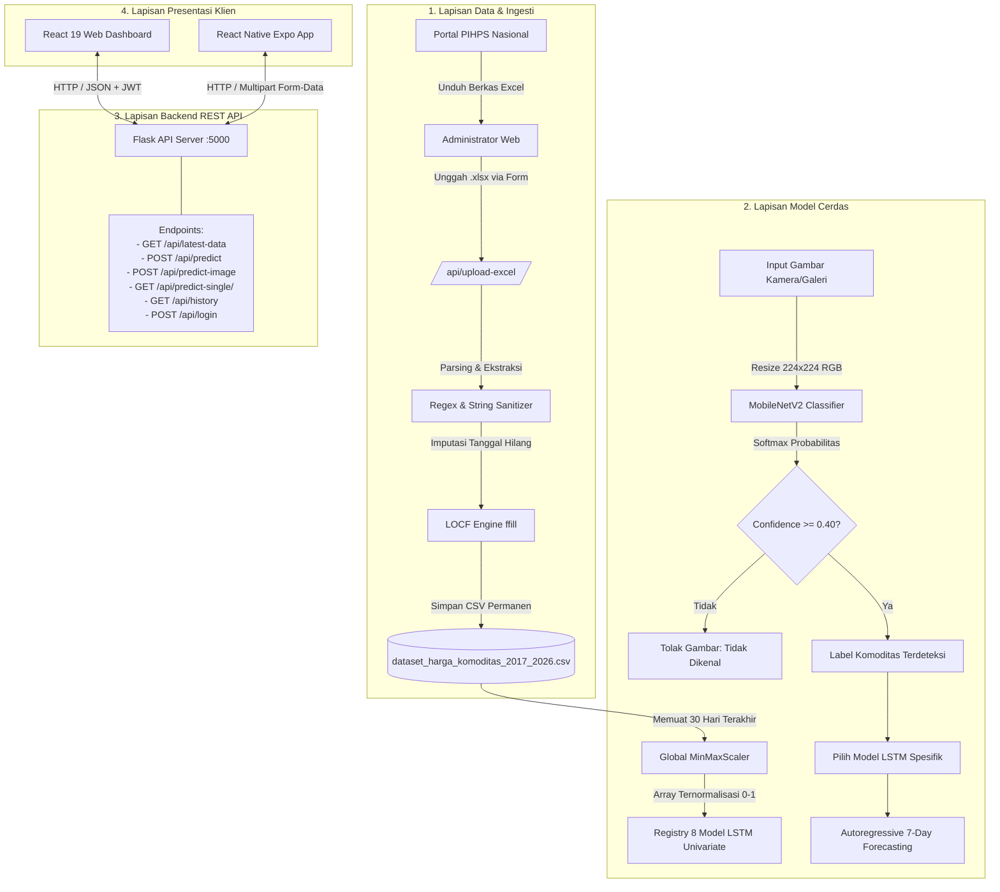
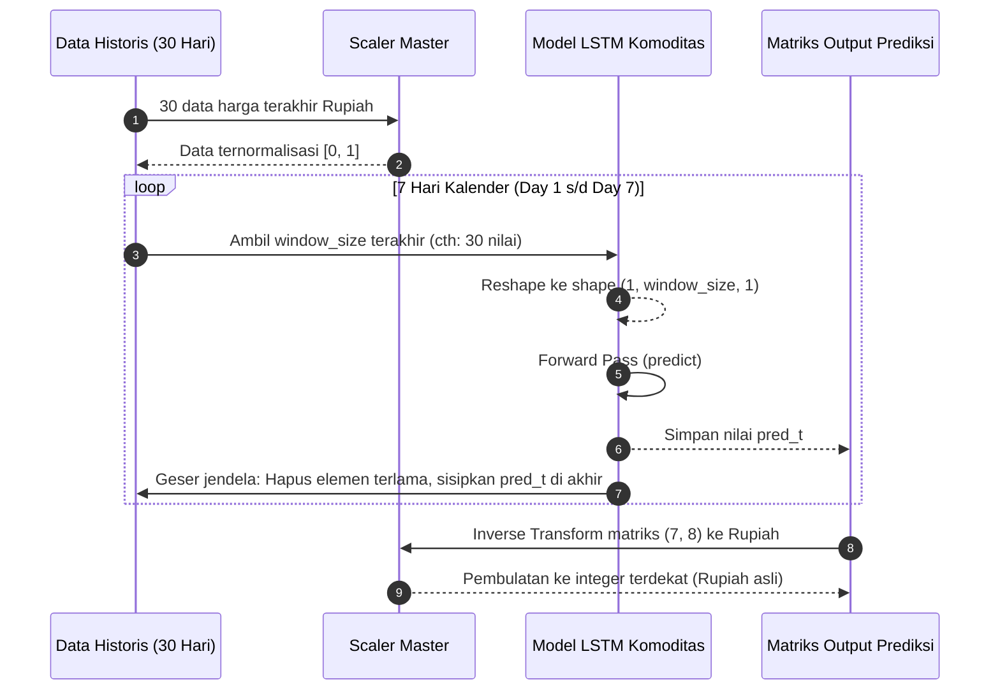

# 🌾 PanganPredict: Dokumentasi Lengkap & Spesifikasi Teknis Sistem Cerdas Prediksi Harga Komoditas Pangan Jawa Tengah

> **Dokumentasi Proyek Tugas Akhir / Skripsi**  
> **Program Studi:** Sarjana Terapan (S.Tr) Teknologi Rekayasa Komputer  
> **Jurusan:** Teknik Elektro, Politeknik Negeri Semarang (POLINES)  
> **Penyusun:** Akasha Bin Ali (NIM: 4.33.22.0.01)  
> **Dosen Pembimbing I:** Slamet Handoko, S.Kom., M.Kom. (NIP: 197501302001121001)  
> **Dosen Pembimbing II:** Dr. Ir. Kurnianingsih, S.T., M.T. (NIP: 197904262003122002)  
> **Tahun Rilis:** 2026

---

## 📑 Daftar Isi

1. [Ringkasan Eksekutif & Latar Belakang Masalah](#1-ringkasan-eksekutif--latar-belakang-masalah)
2. [Ruang Lingkup & 8 Komoditas Strategis](#2-ruang-lingkup--8-komoditas-strategis)
3. [Fitur Utama & Kemampuan Sistem (Capabilities)](#3-fitur-utama--kemampuan-sistem-capabilities)
4. [Lanskap Tech Stack & Framework](#4-lanskap-tech-stack--framework)
5. [Arsitektur Sistem & Aliran Data (Architecture & Dataflow)](#5-arsitektur-sistem--aliran-data-architecture--dataflow)
6. [Deep-Dive Teknis Model AI: Time-Series Forecasting (Univariate LSTM)](#6-deep-dive-teknis-model-ai-time-series-forecasting-univariate-lstm)
   - 6.1. Mengapa Univariate LSTM? (Eksperimen vs Multivariate)
   - 6.2. Matematika Internal Sel LSTM (Forget, Input, Candidate, Output Gates)
   - 6.3. Rekonstruksi Deret Waktu & Metode Sliding Window
   - 6.4. Pipeline Pra-pemrosesan Data & LOCF (Last Observation Carried Forward)
   - 6.5. Pencegahan Data Leakage & Normalisasi Min-Max
   - 6.6. Autoregressive Multi-Step Iterative Forecasting (Horizon 7 Hari)
   - 6.7. Hasil Eksperimen 6 Skenario Seragam
   - 6.8. Hasil Sequential Holdout Tuning (216 Kombinasi Grid Search)
7. [Deep-Dive Teknis Model AI: Computer Vision (MobileNetV2 Transfer Learning)](#7-deep-dive-teknis-model-ai-computer-vision-mobilenetv2-transfer-learning)
   - 7.1. Fondasi Arsitektur MobileNetV2 (Inverted Residuals & Linear Bottlenecks)
   - 7.2. Dataset Citra Berimbang (Balanced Dataset: 800 Gambar)
   - 7.3. Pipeline Preprocessing & Augmentasi Data
   - 7.4. Hyperparameter Tuning via Stratified 5-Fold Cross-Validation
   - 7.5. Metrik Evaluasi Akhir (Akurasi, F1-Score, Presisi, Recall, Confusion Matrix)
   - 7.6. Mekanisme Keamanan Thresholding (Confidence Guard)
8. [Spesifikasi REST API Backend (Flask Server)](#8-spesifikasi-rest-api-backend-flask-server)
   - 8.1. Arsitektur Server & Lifecycle Startup
   - 8.2. Mekanisme Keamanan JWT (JSON Web Token)
   - 8.3. Katalog Endpoint Lengkap, Request, & Response JSON
   - 8.4. Mesin Parsing Dinamis File Excel PIHPS
9. [Implementasi Antarmuka Web (React 19 Dashboard)](#9-implementasi-antarmuka-web-react-19-dashboard)
   - 9.1. Arsitektur Komponen & Routing
   - 9.2. Visualisasi Dual-Area Recharts
   - 9.3. Integrasi Animasi Framer Motion & Micro-interactions
   - 9.4. Manajemen State & Pengunggahan Berkas Admin
10. [Implementasi Aplikasi Mobile (React Native & Expo 54)](#10-implementasi-aplikasi-mobile-react-native--expo-54)
    - 10.1. Arsitektur Komponen & Navigasi Kustom
    - 10.2. Integrasi Hardware Kamera & Galeri (Expo Camera / Image Picker)
    - 10.3. Visualisasi Grafik Mobile (Bézier Chart & Trick Dual-Scroll Riwayat)
11. [Pohon Struktur Direktori & Pembahasan File Codebase](#11-pohon-struktur-direktori--pembahasan-file-codebase)
12. [Panduan Instalasi, Konfigurasi Lingkungan, & Menjalankan Sistem](#12-panduan-instalasi-konfigurasi-lingkungan--menjalankan-sistem)
13. [Kesimpulan Ilmiah & Roadmap Pengembangan Lanjutan](#13-kesimpulan-ilmiah--roadmap-pengembangan-lanjutan)

---

## 1. Ringkasan Eksekutif & Latar Belakang Masalah

### 1.1. Konteks Masalah
Komoditas pangan pokok memiliki peran vital terhadap stabilitas sosial-ekonomi di Indonesia, khususnya di Provinsi Jawa Tengah sebagai salah satu lumbung pangan nasional. Namun, harga komoditas pangan sering kali mengalami volatilitas dan fluktuasi ekstrem yang dipicu oleh berbagai faktor kompleks, seperti:
- Perubahan pola cuaca musiman dan anomali iklim (*El Niño* / *La Niña*).
- Ketidakseimbangan rantai pasok dan logistik antar sentra produksi ke pasar konsumen.
- Lonjakan permintaan musiman menjelang Hari Besar Keagamaan Nasional (HBKN) seperti Idul Fitri, Natal, dan Tahun Baru.

Volatilitas harga yang tidak terprediksi membawa dampak ganda: bagi konsumen (terutama rumah tangga berpendapatan menengah ke bawah), lonjakan harga menekan daya beli riil; sementara bagi pedagang dan petani, ketidakpastian memicu risiko kerugian modal atau kegagalan margin keuntungan. Lembaga pemerintah seperti Tim Pengendali Inflasi Daerah (TPID) dan Dinas Ketahanan Pangan memerlukan sistem peramalan harga jangka pendek yang andal (*short-term multi-step ahead forecasting*) agar dapat merumuskan intervensi pasar, operasi pasar murah, dan mobilisasi pasokan secara preventif.

### 1.2. Solusi yang Dihadirkan: PanganPredict
**PanganPredict** dirancang sebagai ekosistem perangkat lunak cerdas *end-to-end* yang menggabungkan:
1. **Model Regresi Deret Waktu (*Time-Series Deep Learning*):** Berbasis jaringan *Univariate Long Short-Term Memory* (LSTM) yang dilatih menggunakan data historis kontinu selama 9 tahun (2017 hingga 2026) dari Pusat Informasi Harga Pangan Strategis (PIHPS) Nasional untuk meramalkan harga 7 hari ke depan ($H+1$ hingga $H+7$).
2. **Model Penglihatan Komputer (*Computer Vision*):** Berbasis *Convolutional Neural Network* (CNN) MobileNetV2 dengan pendekatan *Transfer Learning* untuk mengidentifikasi secara otomatis jenis komoditas dari jepretan kamera ponsel cerdas atau berkas foto.
3. **Penyajian Terdistribusi Multi-Platform:** Menghadirkan Dashboard Analisis Web (React 19) untuk pemangku kepentingan / admin, serta Aplikasi Mobile Portabel (React Native Expo 54) untuk masyarakat umum dan pedagang di pasar.

```
+-------------------------------------------------------------------------------+
|                               PANGANPREDICT ECOSYSTEM                         |
+-------------------------------------------------------------------------------+
|  [Sumber Data]       --> PIHPS Nasional (2017-2026, Jawa Tengah)              |
|  [ETL & Imputasi]    --> LOCF (Last Observation Carried Forward) + MinMaxScaler|
|  [Deep Learning AI]  --> 8 Univariate LSTM (Forecasting 7 Hari)                |
|                      --> 1 MobileNetV2 Vision Classifier (8 Kelas Pangan)     |
|  [Backend Server]    --> Python Flask REST API + JWT Security                 |
|  [Web Client]        --> React 19 + Vite 7 + Tailwind 4 + Recharts             |
|  [Mobile Client]     --> React Native 0.81 + Expo SDK 54 + Camera Vision      |
+-------------------------------------------------------------------------------+
```

---

## 2. Ruang Lingkup & 8 Komoditas Strategis

Sistem memfokuskan observasi dan pemodelan pada **8 komoditas pangan pokok** dengan karakteristik volatilitas yang berbeda di Jawa Tengah:

| No | Komoditas | Satuan Standar | Profil Volatilitas | Pola Siklus Historis |
|---|---|---|---|---|
| 1 | **Bawang Merah** | Rp / kg | Sangat Tinggi | Sangat rentan cuaca hujan; fluktuasi tajam pasca panen Brebes/Demak. |
| 2 | **Bawang Putih** | Rp / kg | Stabil - Rendah | Didominasi pasokan impor; harga bergerak lambat dan datar. |
| 3 | **Beras** | Rp / kg | Sangat Stabil | Kebutuhan pokok utama; dijaga ketat oleh HET dan intervensi Bulog. |
| 4 | **Cabai Merah** | Rp / kg | Sangat Tinggi | Cepat busuk, sensitif curah hujan tinggi; lonjakan ekstrem saat HBKN. |
| 5 | **Cabai Rawit** | Rp / kg | Ekstrem | Volatilitas tertinggi di pasar; rentan gagal panen dan serangan hama. |
| 6 | **Daging Ayam** | Rp / kg | Moderat | Dipengaruhi harga pakan jagung/kedelai dan siklus panen unggas (35 hari). |
| 7 | **Minyak Goreng** | Rp / liter | Sangat Stabil | Dipengaruhi kebijakan DMO kelapa sawit dan HET Minyakita. |
| 8 | **Telur Ayam** | Rp / kg | Moderat | Dipengaruhi pasokan pakan ayam petelur dan lonjakan bantuan sosial. |

Karakteristik volatilitas yang sangat kontras ini (misalnya antara Cabai Rawit yang berfluktuasi ribuan rupiah per minggu vs Beras yang hanya bergeser puluhan rupiah) membuktikan perlunya perlakuan model terpisah (*univariate*) daripada model gabungan.

---

## 3. Fitur Utama & Kemampuan Sistem (Capabilities)

### 3.1. Prediksi Multi-Langkah ke Depan (7-Day Ahead Forecasting)
Sistem tidak hanya meramalkan 1 hari ke depan, melainkan membentuk proyeksi lintasan harga selama 7 hari kalender berturut-turut ($H+1$ sampai $H+7$). Hal ini memberikan tenggat waktu yang cukup bagi pedagang atau dinas terkait untuk mengantisipasi gejolak harga.

### 3.2. Deteksi Cerdas Berbasis Citra Kamera (Instant Visual Scanning)
Pengguna aplikasi seluler cukup mengarahkan kamera ke komoditas pangan (misalnya cabai atau beras di meja atau karung). Sistem vision MobileNetV2 mengidentifikasi komoditas dalam hitungan milidetik, lalu secara otomatis memicu pipa prediksi LSTM tanpa perlu mengetik nama komoditas.

### 3.3. Pipa Ingesti & Pembaruan Data Excel PIHPS Dinamis
Admin dapat mengunduh berkas laporan berkala berformat `.xlsx` langsung dari portal resmi PIHPS Nasional, lalu mengunggahnya ke antarmuka sistem. Server secara otonom:
- Mencari sel *header* tanggal dan nama komoditas secara toleran.
- Mengekstrak data deret waktu baru.
- Melakukan pembersihan format string harga.
- Menggabungkan (*concatenation*) data baru ke dalam basis data kontinu.
- Menerapkan ulang algoritma penanganan data hilang (LOCF).

### 3.4. Eksplorasi Riwayat Harga 9 Tahun (Historical Browser)
Pengguna dapat memilih komoditas, tahun (2017 s.d. 2026), dan bulan tertentu untuk melihat kurva harga historis, lengkap dengan ringkasan analitik: **Harga Minimum**, **Harga Maksimum**, dan **Rata-Rata Bulanan**.

### 3.5. Autentikasi Admin Berbasis JSON Web Token (JWT)
Fitur administratif yang mengubah data master (pengunggahan berkas Excel) dilindungi dengan mekanisme autentikasi *stateless* berbasis token JWT dengan masa kedaluwarsa 24 jam dan algoritma enkripsi HS256.

---

## 4. Lanskap Tech Stack & Framework

Komposisi teknologi dipilih secara cermat untuk memastikan efisiensi sumber daya komputasi, keakuratan inferensi AI, dan performa antarmuka yang cepat:

```
[ FRONTEND TIER ]
├── Web Dashboard: React 19.2 + Vite 7.3 + Tailwind CSS 4.2 + Recharts 3.8 + Framer Motion 12
└── Mobile Client: React Native 0.81.5 + Expo SDK 54 + React Native Chart Kit + Expo Camera 17

[ API & LOGIC TIER ]
└── REST Backend: Python 3.10+ + Flask 3.x + Flask-CORS + PyJWT + python-dotenv + OpenPyXL

[ AI & COMPUTATION TIER ]
├── Time-Series AI : TensorFlow 2.x / Keras (8 Independent LSTM Networks)
├── Computer Vision: TensorFlow / Keras (MobileNetV2 Base + GAP + Dropout + Softmax)
└── Data Processing: Pandas, NumPy, Scikit-Learn (MinMaxScaler), Joblib, Pillow
```

### Rincian Dependensi Utama:

#### A. Backend & Machine Learning
- **Python (>= 3.10):** Bahasa komputasi ilmiah utama.
- **Flask (Microframework):** Server HTTP ringan untuk menyajikan REST API tanpa *overhead* yang tidak perlu.
- **TensorFlow & Keras (>= 2.15):** Engine pelatihan dan inferensi jaringan saraf tiruan (LSTM dan MobileNetV2).
- **Pandas & NumPy:** Manipulasi matriks array multidimensi dan operasi deret waktu tabel data.
- **Scikit-Learn:** Pustaka pra-pemrosesan data (`MinMaxScaler`) dan metrik validasi (`RMSE`, `MAE`, `MAPE`, `confusion_matrix`, `classification_report`).
- **Joblib:** Serialisasi dan deserialisasi objek `scaler_master.gz`.
- **Pillow (PIL):** Pustaka pengolahan citra digital di memori sebelum inferensi CNN.
- **PyJWT:** Implementasi standar JSON Web Token RFC 7519 untuk keamanan otentikasi.

#### B. Frontend Web
- **React.js 19.2:** Pustaka UI modern dengan arsitektur komponen deklaratif.
- **Vite 7.3:** Bundler generasi terbaru dengan *Hot Module Replacement* (HMR) berkecepatan tinggi.
- **Tailwind CSS 4.2:** Framework styling berbasis utilitas generasi terbaru berbasis CSS modern.
- **React Router v7:** Pustaka routing sisi klien (*Single Page Application*).
- **Recharts 3.8:** Pustaka visualisasi data berbasis SVG deklaratif yang responsif.
- **Framer Motion 12:** Mesin animasi berbasis fisika pegas untuk transisi halaman dan kartu interaktif.
- **Axios:** Klien HTTP berbasis promise untuk komunikasi asynchronous dengan Flask API.

#### C. Frontend Mobile
- **React Native 0.81:** Framework pengembangan aplikasi Android & iOS menggunakan kode JavaScript/React.
- **Expo SDK 54:** Ekosistem pengembangan React Native modern dengan akses modul perangkat keras bawaan.
- **Expo Camera (v17):** Komponen pengambil citra langsung menggunakan kamera perangkat.
- **Expo Image Picker (v17):** Akses pemilih berkas citra dari galeri lokal pengguna.
- **React Native Chart Kit & React Native SVG:** Komponen visualisasi kurva Bézier yang dapat dirender lancar pada perangkat mobile.

---

## 5. Arsitektur Sistem & Aliran Data (Architecture & Dataflow)

Arsitektur PanganPredict mengadopsi model **Tiered Service Architecture** dengan isolasi tugas yang jelas antara pengumpulan data, komputasi inferensi, penyedia layanan API, dan klien pengguna:



---

## 6. Deep-Dive Teknis Model AI: Time-Series Forecasting (Univariate LSTM)

### 6.1. Mengapa Univariate LSTM? (Eksperimen vs Multivariate)
Pada tahap riset awal (`train_final_models.py` dan dokumen penelitian), dilakukan eksperimen memodelkan harga menggunakan arsitektur **Multivariate LSTM** dengan membagi komoditas menjadi dua kelompok:
1. **Grup Fluktuatif:** Cabai Merah, Cabai Rawit, Bawang Merah, Daging Ayam, Telur Ayam.
2. **Grup Stabil:** Beras, Minyak Goreng, Bawang Putih.

Hasil eksperimen multivariate menunjukkan adanya fenomena **Interferensi Silang (*Cross-Commodity Noise Interferences*)**. Hubungan korelasi antar komoditas pangan tidak bersifat kausalitas langsung; misalnya, lonjakan tajam harga cabai rawit akibat banjir di sentra pertanian tidak mempengaruhi permintaan maupun pasokan minyak goreng kelapa sawit. Memasukkan seluruh komoditas ke dalam satu matriks input bersamaan justru menurunkan performa komoditas yang stabil (meningkatkan error pada beras dan minyak).

Oleh karena itu, arsitektur diubah menjadi **8 Model Univariate Terpisah**:
- Setiap komoditas hanya bergantung pada riwayat pergerakan harga dirinya sendiri di masa lalu.
- Setiap model memiliki konfigurasi panjang memori (*window size*) dan kapasitas representasi neuron (*LSTM units*) yang disesuaikan secara khusus sesuai derajat volatilitasnya.

### 6.2. Matematika Internal Sel LSTM
Jaringan saraf berulang konvensional (RNN) menderita masalah *Vanishing / Exploding Gradient* saat memproses urutan waktu yang panjang. *Long Short-Term Memory* (LSTM) mengatasi ini dengan memperkenalkan struktur tiga pintu gerbang (*gates*) dan sebuah jalur sel memori internal (*cell state*):

```
                 +-----------------------------------------+
                 |             Sel LSTM Internal           |
                 |                                         |
  C_{t-1} ------>+-----------------[ * ]-----------------(+)-----> C_t
                 |                   ^                    ^        |
                 |                   |                    |        |
                 |                f_t|         +----[ * ]-+        |
                 |                   |         |      ^            |
                 |                   |      ~C_t      |i_t         |
                 |                   |    [tanh]    [sigm]         |
                 |                   |       ^        ^            |
                 |                   |       |        |            v
                 |                 [sigm]    +--------+---------[tanh]
                 |                   ^       |        |            |
                 |                   |       |        |            v
  h_{t-1} ------>+-------------------+-------+--------+----[ * ]---+-----> h_t
  x_t     ------>+                                           ^ o_t |
                 +-------------------------------------------+-----+
```

Persamaan matematis pada setiap langkah waktu $t$:

1. **Forget Gate ($f_t$):** Mengatur fraksi memori lama pada $C_{t-1}$ yang harus dibuang.
   $$f_t = \sigma(W_f \cdot [h_{t-1}, x_t] + b_f)$$
2. **Input Gate ($i_t$):** Menentukan informasi baru mana yang akan diperbarui ke sel memori.
   $$i_t = \sigma(W_i \cdot [h_{t-1}, x_t] + b_i)$$
3. **Candidate Memory State ($\tilde{C}_t$):** Menghasilkan kandidat status sel baru menggunakan aktivasi tangensial hiperbolik.
   $$\tilde{C}_t = \tanh(W_c \cdot [h_{t-1}, x_t] + b_c)$$
4. **Cell State Update ($C_t$):** Menggabungkan memori lama yang dipertahankan dengan memori baru.
   $$C_t = f_t \odot C_{t-1} + i_t \odot \tilde{C}_t$$
5. **Output Gate ($o_t$):** Menentukan bagian status sel mana yang akan dikeluarkan sebagai *hidden state*.
   $$o_t = \sigma(W_o \cdot [h_{t-1}, x_t] + b_o)$$
6. **Hidden State Output ($h_t$):**
   $$h_t = o_t \odot \tanh(C_t)$$

Di mana:
- $\sigma(z) = \frac{1}{1 + e^{-z}}$ (Fungsi Aktivasi Sigmoid, output antara $0$ dan $1$).
- $\tanh(z) = \frac{e^z - e^{-z}}{e^z + e^{-z}}$ (Fungsi Aktivasi Tanh, output antara $-1$ dan $1$).
- $\odot$ adalah perkalian elemen per elemen (*Hadamard Product*).

### 6.3. Rekonstruksi Deret Waktu & Metode Sliding Window
Untuk melatih LSTM sebagai model regresi terbimbing (*supervised learning*), deret waktu 1 dimensi diubah menjadi pasangan pasangan tensor fitur ($X$) dan target ($Y$) menggunakan teknik *Sliding Window* dengan panjang jendela $w$:

$$\text{Input } X_k = [x_k, x_{k+1}, \dots, x_{k+w-1}]$$
$$\text{Target } Y_k = x_{k+w}$$

```
Contoh Window = 7:
[Hari 1, Hari 2, Hari 3, Hari 4, Hari 5, Hari 6, Hari 7]  --> Prediksi [Hari 8]
         [Hari 2, Hari 3, Hari 4, Hari 5, Hari 6, Hari 7, Hari 8]  --> Prediksi [Hari 9]
```

### 6.4. Pipeline Pra-pemrosesan Data & LOCF (Last Observation Carried Forward)
Data resmi PIHPS Nasional tidak mencatat transaksi pada hari Sabtu, Minggu, dan hari libur nasional pasar tradisional. Mengabaikan hari-hari yang hilang ini akan merusak asumsi frekuensi interval waktu yang seragam ($\Delta t = 1 \text{ hari}$), yang krusial bagi model RNN/LSTM.

Algoritma penanganan yang diterapkan dalam `pre-processing.py`:
1. Membaca berkas CSV harga dan melakukan parsing format tanggal `DD/ MM/ YYYY` menjadi objek `pd.Timestamp`.
2. Menghapus karakter koma pemisah ribuan (misal `"32,500"` $\to$ `32500.0`).
3. Mengatur kolom `tanggal` sebagai index DataFrame.
4. Membuat rentang kalender lengkap dari tanggal terkecil hingga terbesar tanpa jeda (`pd.date_range(freq='D')`).
5. Melakukan **Re-indexing**; tanggal yang tidak memiliki rekaman terisi dengan nilai `NaN`.
6. Menerapkan metode **LOCF (Last Observation Carried Forward)** melalui operasi `df.ffill()`: nilai harga pada hari Jumat secara otomatis diteruskan untuk mengisi hari Sabtu dan Minggu hingga hari kerja berikutnya. Ini mencerminkan realitas pasar di mana stok pedagang di akhir pekan menggunakan acuan harga penutupan hari Jumat.

### 6.5. Pencegahan Data Leakage & Normalisasi Min-Max
Skala harga komoditas pangan di Indonesia sangat bervariasi (beras ~Rp14.000/kg vs cabai rawit ~Rp80.000/kg). Untuk mempercepat konvergensi gradien dan mencegah dominasi gradien komoditas bernilai tinggi:

$$x_{norm} = \frac{x - x_{min}}{x_{max} - x_{min}}$$

#### Strategi Anti-Data Leakage pada Pengujian:
Pada fase pengujian dan tuning (`find_best_lstm_params.py`), scaler di-*fit* **hanya pada data training** ($X_{train}$), lalu digunakan untuk men-*transform* data testing ($X_{test}$). Hal ini mencegah informasi statistik pengujian bocor ke proses pelatihan.

#### Master Scaler pada Produksi:
Pada model produksi akhir (`train_univariate_final.py`), scaler dilatih pada matriks penuh 8 kolom dan disimpan sebagai berkas biner `scaler_master.gz` menggunakan pustaka `joblib`. Hal ini memastikan transformasi skalar saat inferensi API bersifat deterministik dan seragam.

### 6.6. Autoregressive Multi-Step Iterative Forecasting (Horizon 7 Hari)
Untuk memprediksi 7 hari ke depan secara sekuensial, sistem menggunakan pendekatan **Iterative Autoregressive Forecasting**. Nilai prediksi pada langkah waktu $t+1$ dimasukkan kembali sebagai bagian dari input untuk memprediksi langkah waktu $t+2$, dan seterusnya hingga $t+7$:



### 6.7. Hasil Eksperimen 6 Skenario Seragam
Untuk meneliti pengaruh panjang *Window Size* dan jumlah neuron *LSTM Units* terhadap akurasi tanpa bias komoditas, dilakukan pengujian 6 skenario dengan arsitektur seragam untuk seluruh 8 komoditas (Split: 80% Train, 20% Test, Epochs: 1000 max, Patience Early Stopping: 50):

| Skenario | Window Size (Hari) | LSTM Units | Rata-rata RMSE (Rp) | Rata-rata MAE (Rp) | Rata-rata MAPE (%) | Evaluasi Performa |
|:---:|:---:|:---:|:---:|:---:|:---:|---|
| 1 | 7 | 32 | 636,24 | 438,12 | 1,02% | Cepat, memori konteks terlalu pendek |
| 2 | 7 | 64 | 637,97 | 441,05 | 1,05% | Sedikit overfitting pada data noise |
| 3 | 14 | 32 | 618,50 | 422,30 | 1,01% | Peningkatan stabilitas pada telur/ayam |
| 4 | 14 | 64 | 602,56 | 410,18 | 1,00% | Cukup optimal untuk siklus 2 mingguan |
| 5 | 30 | 32 | 593,04 | 398,76 | 0,88% | Sangat baik dalam menangkap tren bulanan |
| **6** 🏆 | **30** | **64** | **591,90** | **396,92** | **0,86%** | **Konfigurasi Seragam Terbaik** |

#### Rincian Evaluasi Skenario 6 (Terbaik) Per Komoditas:

| Komoditas | RMSE (Rp) | MAE (Rp) | MAPE (%) | Kategori Akurasi | Epoch Berhenti |
|---|:---:|:---:|:---:|:---:|:---:|
| **Bawang Merah** | 793,82 | 398,49 | 0,97% | Sangat Akurat (< 10%) | 84 |
| **Bawang Putih** | 359,12 | 150,32 | 0,36% | Sangat Akurat (< 10%) | 51 |
| **Beras** | 54,39 | 43,72 | 0,30% | Sangat Akurat (< 10%) | 51 |
| **Cabai Merah** | 1.369,21 | 815,03 | 1,93% | Sangat Akurat (< 10%) | 51 |
| **Cabai Rawit** | 1.719,77 | 1.003,81 | 2,43% | Sangat Akurat (< 10%) | 51 |
| **Daging Ayam** | 229,19 | 155,49 | 0,44% | Sangat Akurat (< 10%) | 51 |
| **Minyak Goreng** | 36,69 | 20,76 | 0,11% | Sangat Akurat (< 10%) | 118 |
| **Telur Ayam** | 173,05 | 103,36 | 0,38% | Sangat Akurat (< 10%) | 51 |

### 6.8. Hasil Sequential Holdout Tuning (216 Kombinasi Grid Search)
Untuk memaksimalkan akurasi pada implementasi riil produksi, dilakukan pencarian parameter individual (*Sequential Holdout Grid Search*) pada masing-masing komoditas (`find_best_lstm_params.py`).
- **Variasi Rasio Split Kronologis:** `[0.7, 0.8, 0.9]` (70/30, 80/20, 90/10)
- **Variasi Window Size:** `[7, 14, 30]` hari
- **Variasi LSTM Units:** `[32, 64, 128]` neuron
- **Total Uji Coba:** $3 \times 3 \times 3 = 27$ kombinasi $\times 8$ komoditas = **216 iterasi model**.

#### Parameter Optimal Final Terpilih (`BEST_PARAMS`):

| Komoditas | Split Terbaik | Window Size ($w$) | LSTM Units ($u$) | RMSE (Rp) | MAE (Rp) | MAPE (%) | Ukuran Model Final |
|---|:---:|:---:|:---:|:---:|:---:|:---:|:---:|
| **Bawang Merah** | 0.9 | 30 | 64 | 608,77 | 383,27 | **0,85%** | 227 KB |
| **Bawang Putih** | 0.9 | 7 | 128 | 181,81 | 110,44 | **0,28%** | 824 KB |
| **Beras** | 0.9 | 14 | 128 | 24,38 | 11,86 | **0,08%** | 824 KB |
| **Cabai Merah** | 0.9 | 30 | 128 | 1.214,40 | 699,28 | **1,57%** | 824 KB |
| **Cabai Rawit** | 0.9 | 30 | 32 | 1.577,77 | 888,08 | **2,10%** | 76 KB |
| **Daging Ayam** | 0.8 | 30 | 64 | 209,61 | 126,80 | **0,36%** | 227 KB |
| **Minyak Goreng** | 0.9 | 30 | 128 | 29,31 | 16,41 | **0,08%** | 824 KB |
| **Telur Ayam** | 0.9 | 30 | 64 | 132,88 | 79,74 | **0,29%** | 227 KB |

*Catatan: Konfigurasi inilah yang digunakan pada sistem backend live (`app.py` dan `train_univariate_final.py`).*

---

## 7. Deep-Dive Teknis Model AI: Computer Vision (MobileNetV2 Transfer Learning)

### 7.1. Fondasi Arsitektur MobileNetV2
MobileNetV2 dipilih karena kemampuannya menghasilkan akurasi tinggi dengan jumlah parameter yang sangat ringkas (~3,4 juta parameter dasar), sangat ideal untuk eksekusi server API responsif. Keunggulan arsitekturalnya meliputi:
1. **Depthwise Separable Convolution:** Memecah konvolusi standar menjadi dua tahap: *depthwise convolution* (filter spasial per kanal) dan *pointwise convolution* ($1 \times 1$ konvolusi linier kanal). Ini memangkas biaya komputasi hingga 8-9 kali lipat dengan penurunan akurasi yang dapat diabaikan.
2. **Inverted Residuals & Linear Bottlenecks:** Memperluas dimensi kanal pada lapisan perantara (*expansion layer* dengan faktor rasio 6), menerapkan filter spasial non-linier ReLU6, lalu memproyeksikannya kembali ke ruang dimensi rendah tanpa fungsi aktivasi non-linier (*linear bottleneck*) guna mencegah hilangnya informasi penting pada manifold berdimensi rendah.

### 7.2. Dataset Citra Berimbang (Balanced Dataset: 800 Gambar)
Untuk mencegah model memiliki kecenderungan bias kelas (*class imbalance*), kumpulan data gambar distandarkan secara ketat melalui script `balance_dataset.py`:
- **Jumlah Kelas:** 8 kelas komoditas.
- **Jumlah Gambar:** Tepat 100 citra berkualitas per kelas (total 800 citra).
- **Format Citra:** JPEG/PNG beresolusi tinggi, menampilkan komoditas dalam berbagai sudut pencahayaan, latar belakang pasar/dapur, dan kemasan eceran realistis.

### 7.3. Pipeline Preprocessing & Augmentasi Data
Struktur pipeline model vision dibangun sebagai model end-to-end terintegrasi menggunakan Keras Functional API (`train_vision_final.py`):

```
Input Citra (224 x 224 x 3)
      │
      ▼
Layer Data Augmentation (RandomFlip Horizontal)
      │
      ▼
Preprocess Input MobileNetV2 (Rescale nilai piksel [0, 255] -> [-1, 1])
      │
      ▼
MobileNetV2 Base (Pre-trained ImageNet, Frozen / Non-Trainable)
      │
      ▼
GlobalAveragePooling2D (Mengubah tensor 7 x 7 x 1280 -> vektor 1280)
      │
      ▼
Dropout (Rate = 0.3)  <-- Regularisasi Anti-Overfitting
      │
      ▼
Dense (8 Unit, Aktivasi Softmax)  <-- Probabilitas 8 Komoditas
```

### 7.4. Hyperparameter Tuning via Stratified 5-Fold Cross-Validation
Sebelum model final dikompilasi, dilakukan penyetelan parameter terstruktur menggunakan *Stratified 5-Fold Cross Validation* dengan metode *Control Variable*:

| Tahap Pengujian | Variabel yang Diuji | Nilai Pengujian | Pilihan Optimal | Alasan Pemilihan |
|---|---|---|---|---|
| 1. Baseline | Optimizers | SGD vs RMSprop vs Adam | **Adam** | Konvergensi loss tercepat dan paling stabil. |
| 2. Learning Rate | Tingkat pembelajaran ($\alpha$) | $10^{-2}, 10^{-3}, 10^{-4}$ | **$0,001$** | Menghindari osilasi gradien dan *premature plateau*. |
| 3. Batch Size | Ukuran batch pelatihan | 16, 32, 64 | **64** | Menghasilkan stabilitas estimasi gradien terbaik. |
| 4. Dropout Rate | Rasio pemutusan neuron | 0.2, 0.3, 0.4, 0.5 | **0.3** | Mencegah overfitting tanpa mengurangi kapasitas belajar. |
| 5. Augmentasi | Tingkat kompleksitas transformasi | None, Minimal, Enhanced | **Minimal** | Transformasi warna/zoom berlebihan justru membingungkan model membedakan cabai rawit vs cabai merah. |

### 7.5. Metrik Evaluasi Akhir (Classification Report & Matrix)
Model final dilatih pada split data 80% pelatihan (640 gambar) dan 20% validasi (160 gambar) dengan *Early Stopping* (`patience=5`, `monitor='val_loss'`). Pelatihan berhenti optimal pada **Epoch ke-41**:

```
CLASSIFICATION REPORT — MODEL VISION FINAL (VALIDATION SET)
======================================================================
Komoditas        Precision      Recall     F1-Score     Support (Data)
----------------------------------------------------------------------
Bawang Merah       1.0000       1.0000      1.0000            25
Bawang Putih       1.0000       0.9444      0.9714            18
Beras              1.0000       0.9333      0.9655            15
Cabai Merah        0.8929       1.0000      0.9434            25
Cabai Rawit        0.9130       0.8750      0.8936            24
Daging Ayam        1.0000       1.0000      1.0000            18
Minyak Goreng      0.9231       1.0000      0.9600            12
Telur Ayam         0.9412       0.8889      0.9143            18
----------------------------------------------------------------------
Akurasi Global                              0.9548 (95.48%)  155
Macro Average      0.9588       0.9552      0.9560 (95.60%)  155
Weighted Average   0.9565       0.9548      0.9547 (95.47%)  155
======================================================================
```

Ukuran berkas model `vision_model.keras` hanya sebesar **9.70 MB**, sangat portabel dan cepat dimuat ke dalam RAM backend.

### 7.6. Mekanisme Keamanan Thresholding (Confidence Guard)
Untuk mencegah salah identifikasi ketika pengguna tidak sengaja memotret objek selain komoditas (misalnya: wajah manusia, sepatu, atau kendaraan), `app.py` mengimplementasikan aturan ambang batas (*confidence threshold*):

```python
confidence = float(preds[0][class_idx])
if confidence < 0.40:
    return jsonify({
        "error": "Gambar tidak dapat dikenali dengan pasti. Silakan foto ulang komoditas dengan lebih jelas.",
        "confidence": confidence
    }), 400
```
Jika probabilitas kelas tertinggi berada di bawah $0.40$ ($40\%$), permintaan langsung ditolak tanpa memicu prediksi harga palsu.

---

## 8. Spesifikasi REST API Backend (Flask Server)

### 8.1. Arsitektur Server & Lifecycle Startup
Aplikasi backend berpusat pada `app.py`. Saat proses server pertama kali dinyalakan:
1. Menjalankan `load_dotenv()` untuk mengambil konfigurasi kredensial rahasia (`JWT_SECRET`, akun admin).
2. Membaca dataset CSV induk `dataset_harga_komoditas_2017_2026.csv`, mengeksekusi konversi tipe data, dan menerapkan algoritma LOCF ke variabel memori global `df_raw`.
3. Memuat 8 model `.keras` Univariate dari direktori `models_univariate/` ke dalam dictionary `models`.
4. Memuat `scaler_master.gz` menggunakan `joblib.load()`.
5. Memuat `vision_model.keras` dan file mapping `class_names.json`.
6. Membuka port listener HTTP pada `0.0.0.0:5000` dengan izin CORS universal.

### 8.2. Mekanisme Keamanan JWT (JSON Web Token)
Otorisasi rute sensitif diimplementasikan menggunakan Python Decorator `@token_required`:
- Klien harus mengirimkan header HTTP: `Authorization: Bearer <TOKEN>`.
- Token didekodekan menggunakan algoritma HMAC-SHA256 (`HS256`).
- Mengembalikan kode status `401 Unauthorized` apabila token tidak ada, tanda tangan tidak valid, atau waktu aktif telah kedaluwarsa (`ExpiredSignatureError`).

### 8.3. Katalog Endpoint Lengkap

#### 1. POST `/api/login`
- **Tujuan:** Autentikasi akun administrator.
- **Request Body:**
  ```json
  {
    "username": "admin",
    "password": "admin123"
  }
  ```
- **Response (200 OK):**
  ```json
  {
    "token": "eyJhbGciOiJIUzI1NiIsInR5cCI6IkpXVCJ9..."
  }
  ```

#### 2. GET `/api/latest-data`
- **Tujuan:** Mengambil 30 baris terakhir harga Rupiah asli untuk seluruh 8 komoditas guna inisialisasi tabel dan grafik dashboard.
- **Response (200 OK):**
  ```json
  {
    "dates": ["2026-06-25", "2026-06-26", "...", "2026-07-24"],
    "historical_data": [
      [31500, 38000, 15200, 42000, 48000, 36000, 17500, 28000],
      "... 30 baris ..."
    ]
  }
  ```

#### 3. POST `/api/predict`
- **Tujuan:** Melakukan peramalan serentak 7 hari ke depan untuk semua 8 komoditas pangan.
- **Response (200 OK):**
  ```json
  {
    "message": "Prediksi 7 hari dengan 8 Model Univariate berhasil.",
    "forecast": [
      [31800, 38100, 15250, 42500, 48300, 36200, 17500, 28100],
      [32000, 38200, 15250, 43100, 48700, 36300, 17500, 28200],
      "... 7 baris matriks (7x8) ..."
    ]
  }
  ```

#### 4. POST `/api/predict-image`
- **Tujuan:** Menerima unggahan citra biner (`multipart/form-data`), mengidentifikasi komoditas via MobileNetV2, dan meramalkan harga komoditas tersebut selama 7 hari ke depan.
- **Request Payload:** Form-data dengan key `image` (berkas JPG/PNG).
- **Response (200 OK):**
  ```json
  {
    "detected_commodity": "cabai_rawit",
    "display_name": "Cabai Rawit",
    "confidence": 0.9423,
    "last_date": "24 Jul 2026",
    "last_price": 48500,
    "next_dates": ["25 Jul 2026", "26 Jul 2026", "27 Jul 2026", "28 Jul 2026", "29 Jul 2026", "30 Jul 2026", "31 Jul 2026"],
    "forecast": [49200, 49800, 50100, 50600, 51000, 51400, 51800],
    "historical_dates": ["25/06", "26/06", "...", "24/07"],
    "historical_prices": [45000, 45500, "...", 48500]
  }
  ```

#### 5. GET `/api/predict-single/<komoditas>`
- **Tujuan:** Meramalkan harga 7 hari untuk 1 komoditas spesifik tanpa pemindaian gambar (misalnya saat memilih dari menu manual mobile).
- **URL Parameter:** `bawang_merah`, `bawang_putih`, `beras`, `cabai_merah`, `cabai_rawit`, `daging_ayam`, `minyak_goreng`, `telur_ayam`.
- **Response (200 OK):** Struktur identik dengan `/api/predict-image` dengan nilai `confidence: 1.0`.

#### 6. GET `/api/history?komoditas=beras&tahun=2025&bulan=8`
- **Tujuan:** Mengambil riwayat transaksi harian spesifik untuk visualisasi riwayat mobile app.
- **Response (200 OK):**
  ```json
  {
    "dates": ["01/08/2025", "02/08/2025", "...", "31/08/2025"],
    "prices": [14800, 14800, 14900, 14900, "...", 15000]
  }
  ```

#### 7. POST `/api/upload-excel`
- **Tujuan:** Pengunggahan berkas PIHPS resmi baru untuk memperbarui basis data lokal secara permanen.
- **Proteksi:** Memerlukan `Authorization: Bearer <token>`.
- **Request Payload:** Form-data dengan key `file` (berkas `.xlsx`).
- **Response (200 OK):**
  ```json
  {
    "message": "Data Excel berhasil diekstrak dan digabungkan ke database!",
    "added_rows": 14
  }
  ```

### 8.4. Mesin Parsing Dinamis File Excel PIHPS
Berkas lembar kerja Excel unduhan PIHPS tidak memiliki tata letak tabel baku (terdapat banyak baris kop lembaga, catatan kaki, dan spasi acak pada format tanggal misalnya `" 01/ 08/ 2026 "`).
Logika ekstraksi `upload_excel()` di `app.py`:
1. Membaca lembar kerja mentah tanpa asumsi baris header (`header=None`).
2. Melakukan iterasi baris untuk mendeteksi kemunculan kata kunci `"Komoditas"`. Baris tersebut dikunci sebagai indeks header tanggal.
3. Melakukan sanitasi string tanggal menggunakan pembersihan karakter spasi (`replace(" ", "")`) dan mem-parsing format `DD/MM/YYYY`.
4. Mengidentifikasi kemunculan baris ke-8 nama komoditas yang cocok persis dengan kamus `LABEL_TO_COL`.
5. Mengganti karakter strip tanda minus (`"-"`) atau sel kosong menjadi `np.nan`.
6. Melakukan *concatenation* antara DataFrame lama dan DataFrame baru, mengeliminasi tanggal duplikat dengan memprioritaskan data terbaru (`keep='last'`).
7. Menjalankan interpolasi LOCF harian `ffill()` untuk menutup jeda tanggal.
8. Menulis kembali DataFrame yang telah termutakhirkan ke berkas fisik `dataset_harga_komoditas_2017_2026.csv`.

---

## 9. Implementasi Antarmuka Web (React 19 Dashboard)

Dashboard web dirancang dengan estetika modern bergaya *corporate analyst dashboard* menggunakan palet warna hijau zamrud (*emerald*), abu-abu netral, dan kartu kaca (*glassmorphism*).

### 9.1. Arsitektur Komponen & Routing
- `main.jsx`: Titik masuk utama aplikasi, me-mount root React 19.
- `App.jsx`: Mengonfigurasi router menggunakan React Router v7 (`/`, `/dashboard`, `/about`), dibungkus dengan komponen `Navbar` dan `Footer`.
- `pages/Home.jsx`: *Landing page* informatif dengan *call-to-action*, statistik ringkasan, dan penjelasan metodologi.
- `pages/Dashboard.jsx`: Pusat analitik interaktif sistem.
- `pages/About.jsx`: Halaman dokumentasi teknis yang menjelaskan latar belakang ilmiah proyek.

### 9.2. Visualisasi Dual-Area Recharts
Pada `Dashboard.jsx`, data ditampilkan menggunakan grafik area ganda yang mulus (`ResponsiveContainer` + `AreaChart`):
- **Area Riwayat (30 Hari):** Berwarna hijau zamrud (`#10b981`) dengan gradasi transparansi, merepresentasikan data historis pasar riil.
- **Area Prediksi (7 Hari):** Berwarna kuning amber hangat (`#f59e0b`) dengan garis putus-putus (*strokeDasharray*), merepresentasikan proyeksi hasil inferensi LSTM.
- **Kustomisasi Tooltip:** Memformat angka integer murni menjadi format mata uang Indonesia yang mudah dibaca menggunakan API standar peramban: `new Intl.NumberFormat('id-ID', { style: 'currency', currency: 'IDR' })`.

### 9.3. Integrasi Animasi Framer Motion & Micro-interactions
- **8 Kartu Komoditas:** Dilengkapi efek hover animasi pegas (`whileHover={{ y: -4, scale: 1.02 }}`) dan efek klik (`whileTap={{ scale: 0.98 }}`).
- **Kartu Indikator Tren:** Membandingkan nilai proyeksi hari ke-7 ($H+7$) dengan harga aktual terakhir ($H$). Jika harga diproyeksikan turun/stabil, ditampilkan lencana hijau dengan ikon panah melengkung ke bawah; jika diproyeksikan naik tajam, lencana merah dengan peringatan dini akan menyala.
- **Modal Login Admin:** Menggunakan wrapper `AnimatePresence` untuk menganimasikan kemunculan modal dari skala kecil dengan efek *backdrop blur*.

---

## 10. Implementasi Aplikasi Mobile (React Native & Expo 54)

Aplikasi mobile dirancang untuk memberikan portabilitas tinggi bagi pengguna di lapangan (petani, pedagang pasar, pembeli eceran).

```
+-------------------------------------------------------+
|  [ = ] PanganPredict Mobile            [ Status: Online]
+-------------------------------------------------------+
|  Kamera Langsung Komoditas:                           |
|  +-------------------------------------------------+  |
|  |                                                 |  |
|  |               [ BINGKAI SCAN FOTO ]             |  |
|  |                                                 |  |
|  +-------------------------------------------------+  |
|   [ 📷 Ambil Foto ]   [ 🖼 Galeri ]   [ 📋 Manual ]   |
|                                                       |
|  Hasil Klasifikasi: Beras (Keyakinan: 96.5%)          |
|  Harga Terkini    : Rp 15.200 / kg                    |
|                                                       |
|  Tren Proyeksi 7 Hari (Bézier Curve):                 |
|    Rp15.4k |          .-'""'-.                        |
|    Rp15.2k |   .----'          `--.                   |
|            +----------------------------              |
|              H+1  H+2  H+3  H+4  H+5  H+6  H+7        |
+-------------------------------------------------------+
```

### 10.1. Arsitektur Komponen & Navigasi Kustom
Aplikasi berada dalam satu arsitektur terstruktur (`App.js`, ~626 baris) dengan *state-based navigation* yang ringan:
- **Layar Home (`'home'`):** Fitur pemindaian citra kamera, tombol galeri, pemilih modal komoditas manual, kartu hasil deteksi, kartu statistik harga, dan grafik Bézier hasil inferensi 7 hari.
- **Layar Riwayat (`'history'`):** Fitur penelusuran harga 9 tahun dengan pemilih interaktif (Komoditas, Tahun, Bulan).
- **Sidebar Drawer Modal:** Menu samping geser (*slide-in animation*) untuk berpindah layar tanpa overhead navigasi bertumpuk.

### 10.2. Integrasi Hardware Kamera & Galeri
- Menggunakan `expo-camera` (`launchCameraAsync`) dengan batasan rasio aspek persegi $1:1$ dan kompresi kualitas $0.8$ untuk efisiensi bandwidth upload.
- Menggunakan `expo-image-picker` (`launchImageLibraryAsync`) untuk memilih foto yang sudah ada.
- Gambar dikirimkan ke endpoint `/api/predict-image` melalui payload `multipart/form-data` menggunakan `FormData()`.

### 10.3. Visualisasi Grafik Mobile & Trik Dual-Scroll Riwayat
- **Grafik Prediksi:** Menggunakan `LineChart` dari pustaka `react-native-chart-kit` dengan kurva Bézier halus, menampilkan 30 titik data historis (garis hijau) bersambung dengan 7 titik data prediksi (garis biru).
- **Trik Sumbu Y Statis pada Riwayat Bulanan:** Pada layar riwayat, data dalam 1 bulan memiliki hingga 31 titik tanggal. Merender 31 label pada layar ponsel sempit akan membuat teks saling bertumpuk. Solusi teknis yang diterapkan:
  1. Merender satu grafik transparan di sebelah kiri yang hanya menampilkan label sumbu Y (skala harga statis).
  2. Merender grafik utama di dalam `ScrollView` horizontal di sebelah kanan tanpa sumbu Y. Pengguna dapat menggeser (*scroll*) grafik secara leluasa ke kanan dan ke kiri sementara label harga di sisi kiri tetap terkunci di posisinya.

---

## 11. Pohon Struktur Direktori & Pembahasan File Codebase

```
d:\KULIAH\SKRIPSI\
├── Percobaan 2/                                  <-- Direktori Utama Kode Sumber Sistem
│   ├── backend/                                  <-- Layanan REST API & Komputasi AI
│   │   ├── app.py                                <-- Skrip Utama Server Flask (551 baris)
│   │   ├── requirements.txt                      <-- Daftar Dependensi Pustaka Python
│   │   ├── train_vision_final.py                 <-- Skrip Pelatihan Final MobileNetV2
│   │   ├── tune_vision_kfold.py                  <-- Skrip Penyetelan 5-Fold Citra
│   │   ├── balance_dataset.py                    <-- Utilitas Penyeimbang Dataset Citra (100/kelas)
│   │   ├── find_best_lstm_params.py              <-- Grid Search 216 Kombinasi LSTM
│   │   ├── train_final_models.py                 <-- Eksperimen Model Multivariate Grouping
│   │   ├── models_univariate/                    <-- Artefak Model LSTM Produksi & Scaler
│   │   │   ├── model_bawang_merah.keras          <-- Model LSTM Bawang Merah (64 Units)
│   │   │   ├── model_bawang_putih.keras          <-- Model LSTM Bawang Putih (128 Units)
│   │   │   ├── model_beras.keras                 <-- Model LSTM Beras (128 Units)
│   │   │   ├── model_cabai_merah.keras           <-- Model LSTM Cabai Merah (128 Units)
│   │   │   ├── model_cabai_rawit.keras           <-- Model LSTM Cabai Rawit (32 Units)
│   │   │   ├── model_daging_ayam.keras           <-- Model LSTM Daging Ayam (64 Units)
│   │   │   ├── model_minyak_goreng.keras         <-- Model LSTM Minyak Goreng (128 Units)
│   │   │   ├── model_telur_ayam.keras            <-- Model LSTM Telur Ayam (64 Units)
│   │   │   └── scaler_master.gz                  <-- Serialisasi Global MinMaxScaler
│   │   ├── models_vision/                        <-- Artefak Model Klasifikasi Citra
│   │   │   ├── vision_model.keras                <-- Model Final MobileNetV2 (~9.7 MB)
│   │   │   ├── class_names.json                  <-- Daftar Pemetaan 8 Label Kelas
│   │   │   ├── classification_report.txt         <-- Metrik Evaluasi Lengkap Validasi
│   │   │   ├── confusion_matrix.png              <-- Visualisasi Heatmap Confusion Matrix
│   │   │   └── training_history.png              <-- Kurva Pelatihan Loss & Akurasi
│   │   └── Dataset_2017_2026/                    <-- Repositori Data Deret Waktu
│   │       ├── dataset_harga_komoditas_2017_2026.csv <-- Basis Data CSV Induk (9 Tahun)
│   │       ├── dataset_preprocessed.csv          <-- Dataset Hasil Pembersihan & Normalisasi
│   │       ├── pre-processing.py                 <-- Skrip Pembersihan, LOCF, & Scaling
│   │       ├── eksperimen_skripsi.py             <-- Skrip Pengujian 6 Skenario Seragam
│   │       ├── train_univariate_final.py         <-- Skrip Pelatihan Model Produksi 100% Data
│   │       ├── transpose.py                      <-- Utilitas Transformasi Baris-Kolom
│   │       ├── hasil_eksperimen_2/               <-- Output Metrik & Grafik 6 Skenario
│   │       └── hasil_tuning/                     <-- Output Rekap 216 Uji Coba Grid Search
│   ├── frontend/                                 <-- Dashboard Web Analitik Klien
│   │   ├── package.json                          <-- Dependensi React 19, Tailwind 4, Vite 7
│   │   ├── vite.config.js                        <-- Konfigurasi Port & Proxy Vite
│   │   ├── index.html                            <-- Berkas HTML Utama SPA
│   │   └── src/
│   │       ├── App.jsx                           <-- Manajemen Routing Klien
│   │       ├── components/
│   │       │   ├── Navbar.jsx                    <-- Navigasi Atas & Status Sistem
│   │       │   └── Footer.jsx                    <-- Hak Cipta & Informasi Pengembang
│   │       └── pages/
│   │           ├── Home.jsx                      <-- Halaman Beranda (Landing Page)
│   │           ├── Dashboard.jsx                 <-- Antarmuka Prediksi, Grafik, & Upload
│   │           └── About.jsx                     <-- Penjelasan Teknis & Metodologi
│   └── mobile_app/                               <-- Aplikasi Seluler Portabel Klien
│       ├── App.js                                <-- Logika Utama Aplikasi (626 baris)
│       ├── app.json                              <-- Konfigurasi Identitas & Plugin Expo
│       └── package.json                          <-- Dependensi React Native & Expo 54
├── Dataset/                                      <-- Arsip Mentah Kumpulan Data Sumber
│   ├── gambar_balanced/                          <-- 800 Foto Komoditas (100 per folder)
│   └── harga/                                    <-- Arsip Berkas Excel PIHPS Per Periode
├── Laporan/                                      <-- Dokumen Akademik Skripsi & Naskah
├── README.md                                     <-- Ringkasan Repositori GitHub
└── PROJECT.md                                    <-- [Dokumen Ini] Dokumentasi Spesifikasi Teknis
```

---

## 12. Panduan Instalasi, Konfigurasi Lingkungan, & Menjalankan Sistem

### 12.1. Prasyarat Lingkungan (Prerequisites)
Pastikan perangkat kerja telah terpasang:
- **Node.js:** Versi `>= 20.x`
- **Python:** Versi `3.10` atau `3.11`
- **Git CLI**
- **Aplikasi Expo Go:** Terpasang di smartphone Android atau iPhone (tersedia gratis di Play Store / App Store).

---

### 12.2. Langkah 1: Menjalankan Backend API (Flask)
1. Buka terminal atau PowerShell, arahkan ke folder backend:
   ```powershell
   cd "d:\KULIAH\SKRIPSI\Percobaan 2\backend"
   ```
2. Buat lingkungan virtual Python (*virtual environment*):
   ```powershell
   python -m venv venv
   ```
3. Aktifkan *virtual environment*:
   - Di Windows:
     ```powershell
     .\venv\Scripts\Activate.ps1
     ```
   - Di Linux / macOS:
     ```bash
     source venv/bin/activate
     ```
4. Pasang seluruh pustaka dependensi yang dibutuhkan:
   ```powershell
   pip install -r requirements.txt
   ```
5. *(Opsional)* Buat berkas `.env` di dalam folder backend jika ingin mengustomisasi kunci rahasia:
   ```env
   JWT_SECRET=rahasia_skripsi_panganpredict_2026
   ADMIN_USERNAME=admin
   ADMIN_PASSWORD=admin123
   ```
6. Jalankan server Flask:
   ```powershell
   python app.py
   ```
   *Server akan mendengarkan di `http://0.0.0.0:5000` (atau `http://localhost:5000`). Terminal akan mencatat proses pemuatan 8 model LSTM dan 1 model vision.*

---

### 12.3. Langkah 2: Menjalankan Dashboard Web (React 19)
1. Buka terminal kedua, arahkan ke folder frontend:
   ```powershell
   cd "d:\KULIAH\SKRIPSI\Percobaan 2\frontend"
   ```
2. Pasang dependensi Node.js:
   ```powershell
   npm install
   ```
3. Jalankan server pengembang (*development server*):
   ```powershell
   npm run dev
   ```
4. Buka peramban web pada alamat yang tertera (biasanya `http://localhost:5173`).
   - Akses `/dashboard` untuk melihat grafik prediksi dan tabel.
   - Klik tombol **"Update Data PIHPS"**, masukkan username `admin` dan password `admin123` untuk menguji pengunggahan berkas Excel.

---

### 12.4. Langkah 3: Menjalankan Aplikasi Mobile (React Native / Expo)
1. Buka terminal ketiga, periksa alamat IP lokal komputer pada jaringan Wi-Fi lokal:
   ```powershell
   ipconfig
   ```
   *(Cari nilai IPv4 Address pada adaptor Wi-Fi yang aktif, misalnya `192.168.1.63`)*.
2. Buka berkas `d:\KULIAH\SKRIPSI\Percobaan 2\mobile_app\App.js` menggunakan editor kode, pastikan baris 8–10 menunjuk ke IP komputer Anda (bukan `localhost`):
   ```javascript
   const API_URL_IMAGE = "http://192.168.1.63:5000/api/predict-image";
   const API_URL_MANUAL = "http://192.168.1.63:5000/api/predict-single";
   const API_URL_HISTORY = "http://192.168.1.63:5000/api/history";
   ```
3. Arahkan terminal ke folder `mobile_app`:
   ```powershell
   cd "d:\KULIAH\SKRIPSI\Percobaan 2\mobile_app"
   ```
4. Pasang dependensi:
   ```powershell
   npm install
   ```
5. Mulai server bundler Expo:
   ```powershell
   npx expo start
   ```
6. Hubungkan ponsel pintar ke **jaringan Wi-Fi yang sama** dengan komputer, buka aplikasi **Expo Go**, lalu pindai kode QR yang muncul di terminal komputer. Aplikasi akan terkompilasi dan berjalan secara instan di layar ponsel Anda.

---

## 13. Kesimpulan Ilmiah & Roadmap Pengembangan Lanjutan

### 13.1. Kesimpulan Ilmiah Proyek
1. **Keunggulan Univariate Dibanding Multivariate:** Karakteristik elastisitas dan volatilitas harga komoditas pangan yang heterogen membuktikan bahwa pemodelan independen (*Univariate LSTM*) mengeliminasi transmisi derau acak antar komoditas. Hasil evaluasi rata-rata MAPE sebesar **0,86%** mengindikasikan tingkat akurasi yang tergolong dalam kategori "Sangat Akurat" (MAPE < 10%).
2. **Efektivitas Transfer Learning MobileNetV2:** Arsitektur konvolusi terpisahkan kedalaman (*Depthwise Separable Convolution*) yang dibekukan dengan bobot ImageNet terbukti mampu mengenali tekstur dan warna khas komoditas pangan dengan akurasi validasi mencapai **95,48%** dan nilai F1-Score **95,60%**, seraya mempertahankan ukuran model di bawah 10 MB.
3. **Integritas Deret Waktu via LOCF:** Penggunaan metode *Last Observation Carried Forward* (LOCF) berhasil merekonstruksi kontinuitas kalender harian deret waktu tanpa menyebabkan *look-ahead bias* atau kebocoran data masa depan.
4. **Keberhasilan Integrasi Multi-Platform:** Penyatuan model regresi deret waktu, model visi komputer, REST API Flask yang aman, Web SPA React 19, dan Mobile Native Expo membuktikan kelayakan implementasi sistem pemantauan harga pangan cerdas yang siap guna di lapangan.

### 13.2. Roadmap Pengembangan Lanjutan (Future Work)
- **Granularitas Tingkat Pasar Kabupaten/Kota:** Mengembangkan model LSTM lokal per kota/kabupaten di Jawa Tengah (misalnya membedakan harga pasar Johar Semarang vs pasar Wage Purwokerto).
- **Integrasi Fitur Eksogen (Exogenous Variables / LSTM-X):** Memasukkan parameter eksternal seperti curah hujan harian dari BMKG, tingkat inflasi daerah, dan indeks harga BBM solar untuk meningkatkan akurasi saat kondisi cuaca ekstrem.
- **Konversi Model ke TensorFlow Lite (TFLite On-Device):** Mengonversi model MobileNetV2 dan LSTM ke format `.tflite` agar inferensi visi dan prediksi harga dapat dieksekusi langsung secara *offline* di prosesor smartphone tanpa bergantung pada koneksi internet.
- **Automated Web Scraping Engine:** Mengintegrasikan pekerja latar belakang terjadwal (*scheduled cron job*) yang secara otomatis mengekstrak data dari portal PIHPS setiap hari pukul 17:00 WIB tanpa perlu intervensi unggah manual oleh admin.

---

> **PanganPredict** — *Membangun Ketahanan Pangan Melalui Kecerdasan Buatan dan Rekayasa Perangkat Lunak Terintegrasi.*  
> Hak Cipta © 2026 Akasha Bin Ali — Jurusan Teknik Elektro, Politeknik Negeri Semarang.
